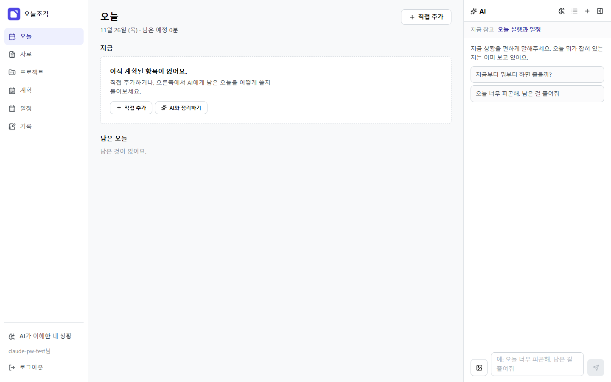
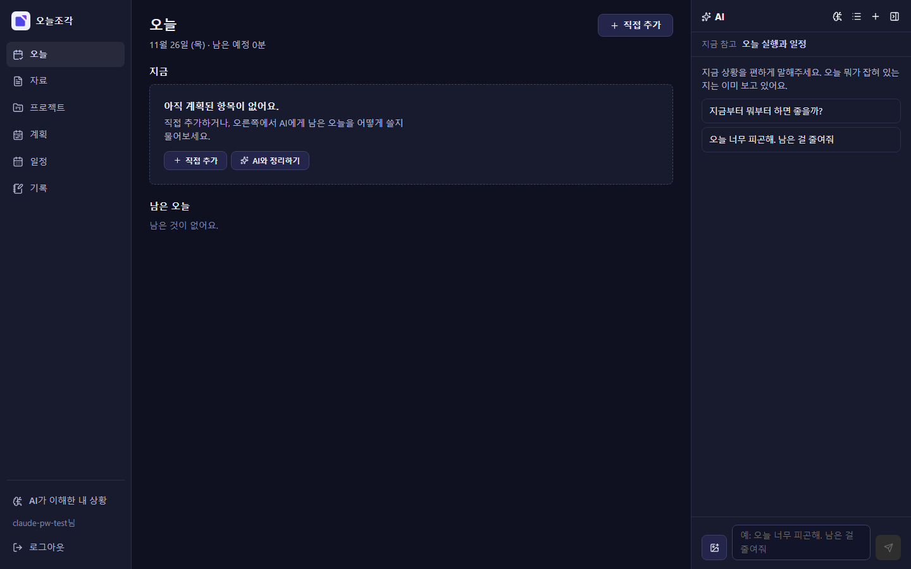
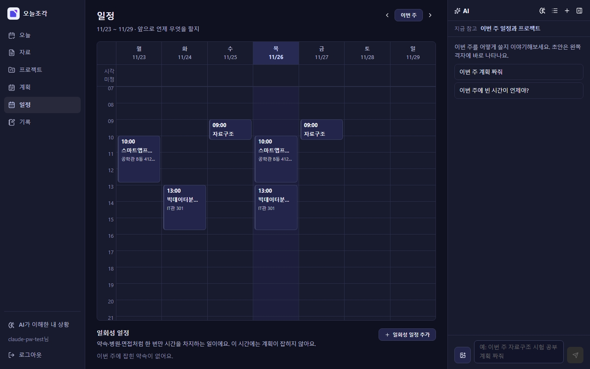
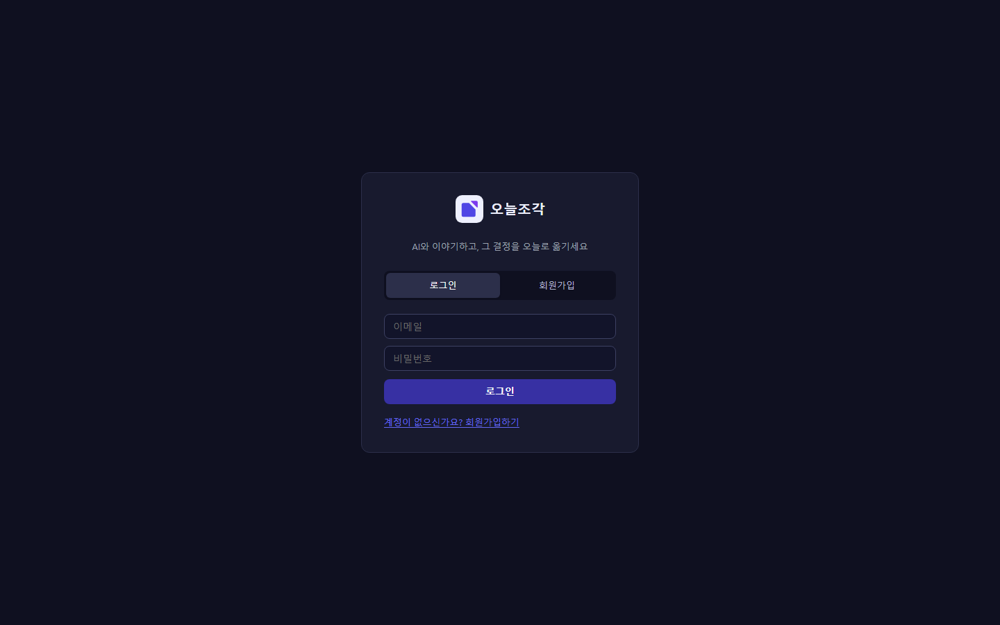

# 앱 아이콘과 다크모드 구상

2026-11-26 기준. 밝은 화면용 로고·파비콘·강조색은 앱에 적용했다(`src/ui/Logo.jsx`, `public/favicon.svg`, `src/ui/theme.js`, `src/styles/mantine-tokens.css`). 다크모드는 아직 없다. 시안은 `memo_app_work/icon-sandbox/`(앱 복사본)에서 만들어 캡처로 비교했다.

## 아이콘: 떼어낸 모서리

네모 한 장에서 오른쪽 위 모서리 조각을 떼어낸 모양. 네모가 하루(또는 계획 전체), 떼어낸 조각이 "오늘 몫"이다.

| 쓰는 곳 | 파일 | 바탕 | 몸통 | 조각 |
|---|---|---|---|---|
| 밝은 화면(기본) | [app-icon-light.svg](icons/app-icon-light.svg) | 남색 `#4f46e5` | 흰색 `#ffffff` | 연한 남색 `#c7d2fe` |
| 다크모드 | [app-icon-dark.svg](icons/app-icon-dark.svg) | 연한 남색 `#eef0fe` | 남색 `#4f46e5` | 보라 `#7c3aed` |

| 밝은 화면용 | 다크모드용 |
|---|---|
|  |  |

두 벌로 나눈 이유: 로고는 바탕과 얼마나 다르냐로 눈에 띈다. 흰 사이드바에서는 남색 바탕이 가장 진한 점이 되고, 어두운 사이드바에서는 연한 바탕이 가장 밝은 점이 된다. 반대로 쓰면 둘 다 바탕에 묻힌다(샌드박스 시안 A·B에서 연한 바탕 로고가 흰 사이드바에 묻히는 것을 확인했다).

모양 규칙
- 그림판은 64×64, 바탕 모서리 둥글기 15.
- 몸통은 (14,18)~(46,50), 조각은 몸통 밖으로 4만큼 오른쪽 위로 나가 있다. 두 조각 사이 틈은 16px 파비콘에서도 붙어 보이지 않는 폭이다.
- 조각 색은 다크모드에서 AI 초안 색(보라)과 같은 계열이다 — "AI가 떼어 준 오늘 몫".

### 다른 앱과 겹치는지 본 것

한국 앱스토어에서 시간표·캘린더·플래너·일정 관리·스터디 플래너 검색 상위 67개 아이콘과 대조했다(구글플레이·상표 등록은 확인하지 않음).
- 똑같은 모양은 없었다.
- 가까운 것: **모눈**(초록 네모의 오른쪽 위에 흰 네모 조각 — 발상이 비슷하다), **StudyNavi**(거의 같은 남색 바탕에 흰 도형 — 색 인상이 비슷하다).
- 이름 "오늘조각"과 같은 앱은 못 찾았다. 가까운 이름은 "오늘 밤, 조각모음"(미팅), "오늘의 조각그림 퍼즐"(게임)로 분야가 다르다.

## 밝은 화면: 강조색을 로고에 맞춘다

전에는 강조색이 Mantine 기본 파랑이었다. 로고가 남색이라 그대로 두면 로고와 버튼·선택된 메뉴 색이 어긋나서, 로고와 함께 강조색도 남색으로 바꿨다.

`--ws-accent`(`#4f46e5`), `--ws-accent-soft`(`#eef0fe`), `--ws-accent-text`(`#3730a3`)가 아래 팔레트의 6·0·8번 단계에 묶여 있다. AI 초안 색(`--ws-draft`)은 Mantine 보라 그대로 둔다.

Mantine `primaryColor`용 10단계(6번이 `#4f46e5`):
`#eef0fe #e0e7ff #c7d2fe #a5b4fc #818cf8 #6366f1 #4f46e5 #4338ca #3730a3 #312e81`

## 다크모드 구상 (나중에)

지금 앱에는 다크모드가 없다. 만들 때 아래를 출발점으로 쓴다. 샌드박스 시안 E에서 쓴 값이고, 눈에 띄는 곳만 덮은 대략 시안이라 화면마다 다시 잡아야 한다.

| 변수 | 값 | 쓰임 |
|---|---|---|
| `--ws-bg` | `#0f1020` | 화면 바탕 |
| `--ws-surface` | `#181a2e` | 사이드바·카드 |
| `--ws-border` | `#2c2f4a` | 구분선 |
| `--ws-border-strong` | `#3d4163` | 입력칸 테두리 |
| `--ws-text` | `#eceefb` | 본문 |
| `--ws-text-dim` | `#b4b8d4` | 보조 글자 |
| `--ws-text-faint` | `#8286a6` | 흐린 글자 |
| `--ws-accent` | `#818cf8` | 강조(밝은 화면보다 두 단계 밝게) |
| `--ws-accent-soft` | `#272a52` | 선택된 메뉴 바탕 |
| `--ws-accent-text` | `#c7d2fe` | 강조 글자 |
| `--ws-draft` | `#a78bfa` | AI 초안 |
| `--ws-draft-soft` | `#2a2350` | AI 초안 바탕 |

만들 때 해야 할 일
- `MantineProvider`의 색 모드를 어둡게 바꾸는 것만으로는 안 된다. `--ws-*` 변수가 Mantine의 밝은 단계에 묶여 있어(`styles/mantine-tokens.css`) 따로 뒤집어야 한다.
- `workspace.css`·`App.css`에 밝은 색이 직접 박힌 곳이 수십 군데 있다(`#fff`, `#f0f2f5`, `#fafbfc`, `#fbfbfc` 등 — AI 패널, 일정표 칸, 실행 줄, 입력칸, 로그인 화면). 변수로 바꿔야 한다.
- 일정표 블록·상태 배지처럼 색으로 뜻을 나누는 곳은 어두운 바탕에서 대비를 다시 확인한다.
- 로고는 다크모드에서 `app-icon-dark.svg`로 바꾼다.

## 시안 다시 보기

`memo_app_work/icon-sandbox/` — `.claude/launch.json`의 `icon-sandbox`(포트 5196). 주소 끝 `?v=`로 고른다.

| 값 | 내용 |
|---|---|
| `current` | 지금 앱 |
| `a` | 로고만 교체(연한 바탕) |
| `b` | a + 강조색 남색 |
| `c` | b + 짙은 사이드바 |
| `d` | 밝은 화면 최종안: 남색 바탕 로고 + 강조색 남색 |
| `e` | 다크모드 대략 시안 + 연한 바탕 로고 |

캡처: `node icon-sandbox/scripts/capture.mjs` 뒤 `node icon-sandbox/scripts/sheets.mjs`. 결과는 `icon-sandbox/screenshots/`.
